# Manual do Usuário
## Calculadora de Precificação para Eventos e Churrascos

**Versão do manual:** outubro de 2026. Inclui Agenda, Funil de Vendas, Tarefas, Mensagens prontas, Relatórios, Estoque e Vendas.

As imagens deste manual usam uma empresa e clientes de exemplo.

---

## Novidades desta versão

- **Atualizar pratos nos cardápios:** editou um prato (ingredientes, rendimento, margem ou nome)? Toque em **"Atualizar pratos"** na aba Cardápio ou em **"Atualizar pratos de todos"** na aba Salvos. Os cardápios passam a usar os dados atuais do prato, e as porções por pessoa continuam as mesmas.
- **Insumos do cliente:** quando o cliente compra os insumos (todos ou parte), marque o que ele compra. Isso sai do custo e do preço, você cobra uma taxa de preparo por convidado, e a proposta mostra a lista do que o cliente precisa comprar.
- **Vendas (Premium):** venda de pratos no balcão, mesa, retirada, delivery e encomenda, com **impressão do pedido** em qualquer impressora (térmica 80/58 mm ou folha A4/A5), **estoque de pratos prontos** (marmitas, congelados, bebidas) com validade, **produção sugerida** pelas encomendas e o **resumo do dia** com o lucro bruto.
- **Margens do evento:** o Resumo mostra a margem bruta, a operacional e a líquida, com a conta.
- **Estoque de insumos (Premium):** registre compras, dê baixa no estoque ao confirmar o evento, lance sobras e perdas e veja a **compra sugerida** para os eventos fechados dos próximos dias. Agora também com **validade** (aviso antes de vencer), **apoio no estoque** (carvão, copos, gás), **inventário** e lançamentos **sem internet**.
- **Apoio automático:** cada item de apoio pode ter uma regra (por convidado, por kg de carne, por hora ou fixo por evento) e a embalagem de compra. O app calcula quanto comprar e arredonda para pacotes inteiros. Também há **kits** prontos por tipo de evento.
- **Preços mais precisos:**
  - **Custo dos pratos:** a perda dos ingredientes era contada duas vezes. Agora ela só reduz o peso final, e custos e preços sugeridos ficaram corretos (em geral, menores). O app recalcula seus pratos sozinho na primeira vez que você entrar depois da atualização.
  - **Propostas:** usam o cardápio e os convidados da própria proposta e mostram o lucro estimado. Elas vêm com o markup dos pratos e avisam quando estão sem lucro.
- **Custos da empresa:** cadastre impostos, taxas de cartão, custos fixos e lucro desejado. A proposta pode calcular o preço por esses custos (método do divisor).
- **Mão de obra por equipe:** função, número de pessoas, horas, valor/hora e encargos.
- **Lista de compras:**
  - arredonda pela embalagem (100 g de pimenta, e não 1 kg);
  - o custo do evento considera o que é usado.
- **Mensagens prontas para WhatsApp:** escolha um modelo (primeiro contato, retorno da proposta, confirmação, pagamento, agradecimento, avaliação e recontato) e o texto já vem com o nome do cliente, o evento, a data e o valor.
- **Modelos editáveis:** escreva os textos do seu jeito, crie modelos novos e cadastre o link de avaliação do Google.
- **Relatórios (Premium):** taxa de fechamento, ticket médio, faturamento por mês, vendas por origem e motivos de perda.
- **Pós-venda automático:** no dia seguinte ao evento o sistema cria a tarefa "Agradecer e pedir avaliação". Perto de completar um ano, cria a tarefa "Recontatar para o próximo evento".
- **Origem "Site":** para os contatos que chegam pelo site.
- **Agenda, Funil de Vendas, ficha do cliente e tarefas**, com retorno automático de propostas paradas.

---

## 1. Sobre o sistema

A Calculadora de Precificação organiza todo o trabalho de quem vende eventos, churrascos e buffets:

- Calcula o custo real de cada prato, com perda e rendimento dos ingredientes.
- Monta cardápios e gera a lista de compras para o número de convidados.
- Soma apoio, transporte e mão de obra ao custo do evento.
- Gera propostas comerciais com a identidade da sua empresa.
- Mostra na Agenda as datas fechadas e em negociação.
- Acompanha clientes, conversas, tarefas e resultados no Funil de Vendas (CRM).
- Prepara as mensagens de WhatsApp para cada etapa da venda.

---

## 2. Acesso ao sistema

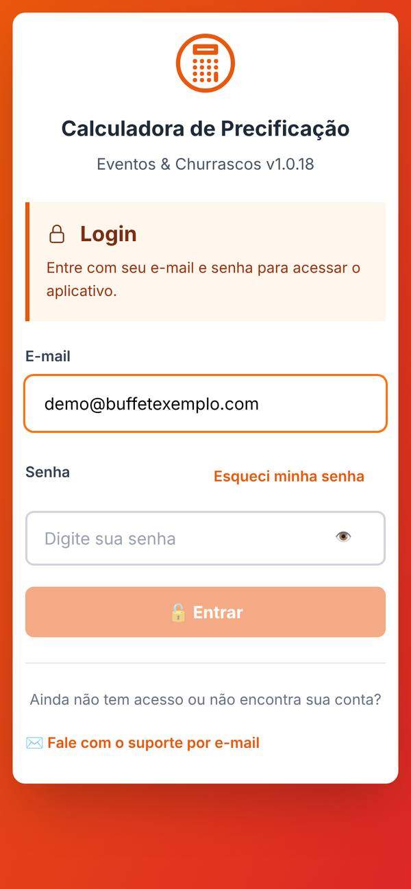

### 2.1 Primeiro acesso

1. Digite o **e-mail** da sua conta.
2. Crie uma **senha** com no mínimo 8 caracteres, uma letra maiúscula e um número, e repita no campo "Confirmar Senha".
3. Toque em **"Criar Senha e Entrar"**.

### 2.2 Próximos acessos

1. Digite o e-mail e a senha.
2. Toque em **"Entrar"**.

### 2.3 Esqueci minha senha

1. Na tela de acesso, toque em **"Esqueci minha senha"**.
2. Confirme. Em seguida, você cria uma senha nova.

### 2.4 Alterar a senha

Já dentro do sistema, toque em **"🔑 Alterar senha"** no painel lateral (abaixo de "Custos da empresa").

1. Digite a **senha atual**.
2. Digite a **nova senha** (mínimo 8 caracteres, uma letra maiúscula e um número) e confirme.
3. Toque em **"Alterar senha"**.

Não lembra a senha atual? Toque em **"Esqueci a senha atual"**: enviamos um código de 6 dígitos para o e-mail da conta. Digite o código no lugar da senha atual. A senha nova vale para todos os aparelhos (é preciso estar com internet).

### 2.5 Não encontra sua conta?

Use o botão **"Fale com o suporte por e-mail"** na tela de acesso.

---

## 3. Visão geral

### 3.1 Abas

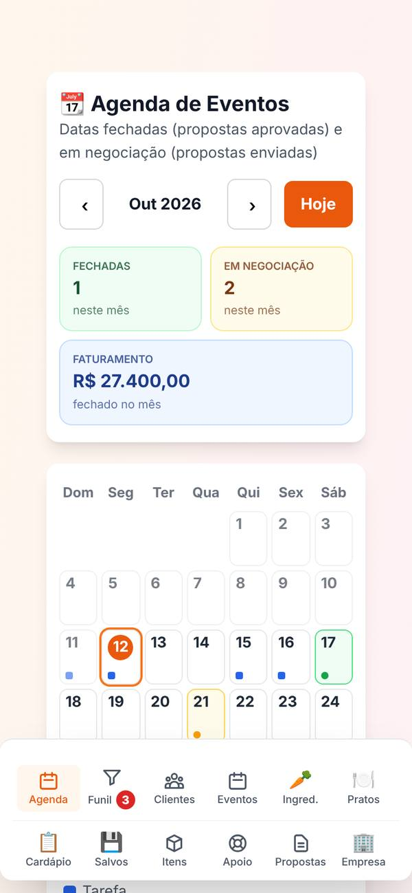

- **Agenda:** calendário das datas fechadas, em negociação e das tarefas do dia. É a aba que abre primeiro.
- **Funil:** funil de vendas, tarefas, relatórios e ficha de cada cliente (Premium).
- **Clientes:** cadastro de clientes.
- **Eventos:** dados do evento (cliente, data, convidados, local) e eventos salvos.
- **Ingredientes:** banco de ingredientes com custo, perda e rendimento.
- **Pratos:** receitas com custo, markup e preço sugerido.
- **Cardápio:** pratos do evento atual e consumo por pessoa.
- **Salvos:** cardápios salvos para reutilizar.
- **Itens:** lista de compras do evento.
- **Apoio:** itens de apoio e logística, transporte e mão de obra.
- **Estoque:** compras, saldo, validade, apoio, inventário, baixa dos eventos e compra sugerida (Premium).
- **Vendas:** venda de pratos (PDV), pedidos, encomendas, impressão, estoque de prontos e resumo das vendas (Premium).
- **Propostas:** criação, envio e acompanhamento das propostas.
- **WhatsApp:** configuração do envio de propostas em PDF pelo WhatsApp (Premium, no computador).
- **Empresa (no celular):** abre o painel da empresa, com os dados da empresa, o suporte e este manual.

No celular, as abas ficam na barra inferior. No computador, ficam no topo da tela.

### 3.2 Painel da empresa

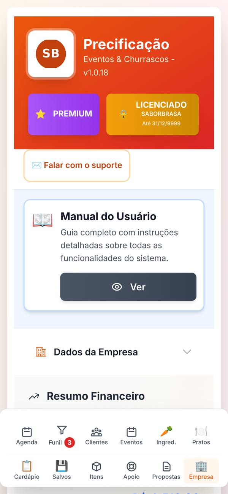

O painel da empresa reúne:

- o logo, o plano e a licença;
- o botão **"Falar com o suporte"**;
- este manual (botão **"Ver"**);
- os **Dados da Empresa** e o **Resumo Financeiro** do evento atual.

Onde encontrar o painel:

- **No computador:** ele fica sempre à esquerda da tela.
- **No celular:** toque em **"Empresa"** na barra inferior. Para voltar, toque em qualquer outra aba.

### 3.3 Passo a passo de um orçamento

1. **Ingredientes:** cadastre os ingredientes com o preço que você paga.
2. **Pratos:** crie os pratos com os ingredientes e defina o markup.
3. **Cardápio:** adicione os pratos do evento e ajuste o consumo por pessoa.
4. **Salvar cardápio (opcional):** guarde o cardápio para reutilizar em outros eventos.
5. **Clientes:** cadastre o cliente na aba Clientes ou crie o contato direto no Funil.
6. **Propostas:** crie a proposta. Ela já vem com o cardápio do evento aberto, e você pode trocar por um cardápio salvo.
7. **Funil e Agenda:** envie a proposta e acompanhe. Quando ela for aprovada, a data aparece como fechada na Agenda.

> **Exemplo completo:** a Mariana pediu um orçamento de casamento para 120 convidados.
> 1. Você cria o contato "Mariana Costa" no Funil, com origem Instagram e etiqueta Casamento.
> 2. Monta o cardápio "Churrasco Completo" e salva.
> 3. Cria a proposta "Casamento Mariana & Lucas" com esse cardápio e manda pelo WhatsApp.
> 4. Marca a proposta como **Enviada**.
> 5. Três dias depois, sem resposta, o sistema cria a tarefa de retorno. Você abre a **Mensagem pronta** "Retorno da proposta" e envia.
> 6. Ela aprova: você marca como **Aprovada** e a data fica verde na Agenda.

---

## 4. Dados da empresa

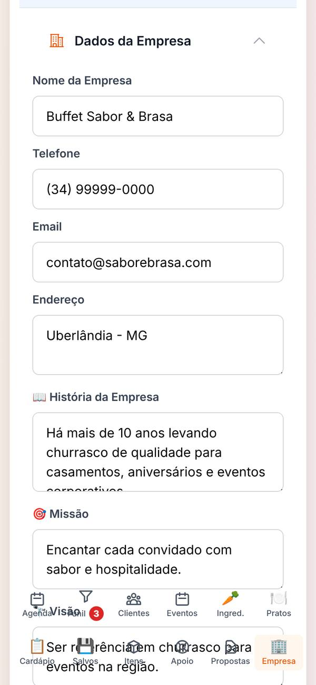

Os dados da empresa aparecem nas propostas e o nome da empresa entra nas mensagens prontas. Eles ficam guardados na sua conta, então são os mesmos em todos os aparelhos.

1. No painel da empresa, toque em **"Dados da Empresa"** para abrir o formulário.
2. Preencha nome, telefone, e-mail e endereço.
3. Para a apresentação da proposta, preencha também história, missão, visão, valores e motivação/diferenciais.
4. Adicione até 3 fotos: principal, ambiente/equipe e produtos/serviços.
5. Toque em **"Salvar Dados da Empresa"**.

Para colocar o **logo**, toque no círculo no topo do painel e escolha a imagem.

> **Dica:** escreva a história em 2 ou 3 frases curtas. Por exemplo: "Há mais de 10 anos levando churrasco de qualidade para casamentos, aniversários e eventos corporativos."

### 4.1 Custos da empresa (impostos, taxas e lucro)

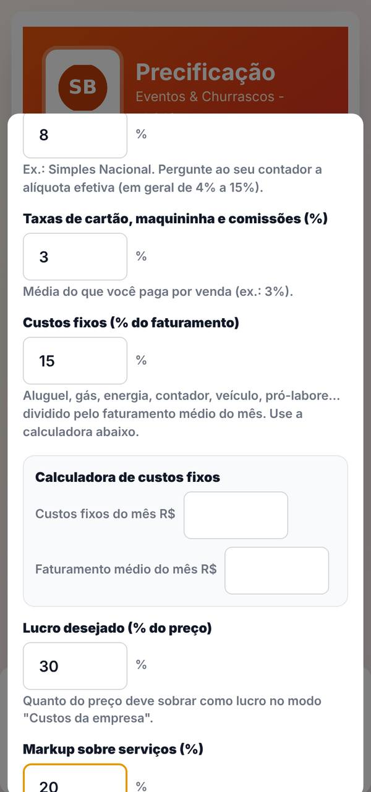

No painel da empresa, toque em **"📊 Custos da empresa"**. Os percentuais entram nas propostas para mostrar o **lucro de verdade** e, se você quiser, para **calcular o preço**.

| Campo | O que é | Exemplo |
|---|---|---|
| Impostos sobre a venda | alíquota efetiva do seu regime (pergunte ao contador) | 8% |
| Taxas de cartão e comissões | média do que você paga por venda | 3% |
| Custos fixos | aluguel, gás, energia, contador, veículo, pró-labore ÷ faturamento do mês | 15% |
| Lucro desejado | quanto do preço deve sobrar de lucro | 20% |
| Markup sobre serviços | quanto somar ao custo de apoio, mão de obra e transporte | 20% |
| Correção mensal | correção de comida e apoio até a data do evento | 1% |
| Margem de segurança das proteínas | carne a mais para não faltar: ingredientes da categoria Proteínas saem esse % a mais na compra e no custo | 15% |

A **calculadora de custos fixos** faz a conta: custos fixos do mês ÷ faturamento médio do mês.

> **Exemplo do método do divisor:**
> - custo direto do evento: R$ 10.000;
> - impostos 8% + taxas 3% + custos fixos 15% + lucro 20% = 46%;
> - preço = 10.000 ÷ (1 − 0,46) = **R$ 18.518,52**.
>
> Desse valor: R$ 2.037 vão para impostos e taxas, R$ 2.778 para os custos fixos e R$ 3.704 são lucro.

---

## 5. Agenda

A Agenda é a primeira tela do sistema e mostra o mês em forma de calendário.

### 5.1 O que aparece no calendário

- **Fechada (verde):** proposta marcada como "Aprovada".
- **Em negociação (amarelo):** proposta marcada como "Enviada".
- **Tarefas (azul, Premium):** tarefas com data naquele dia.
- **Alerta de conflito (vermelho):** proposta enviada para uma data que já está fechada. O alerta evita vender a mesma data duas vezes.

No topo ficam o total de datas fechadas e em negociação do mês e o faturamento fechado no mês.

### 5.2 Como usar

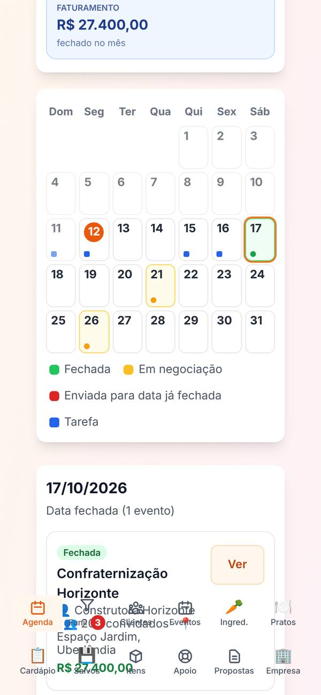

- Use as setas para trocar de mês e **"Hoje"** para voltar ao mês atual.
- Toque em um dia para ver os eventos e as **"Tarefas do dia"**. As tarefas podem ser concluídas ali mesmo.
- A lista **"Próximos eventos fechados"** mostra o que vem pela frente.
- Se uma proposta aprovada estiver sem data do evento, a Agenda avisa. Edite a proposta e informe a data.

> **Exemplo:** um cliente pergunta se você tem o dia 17 livre. Abra a Agenda e veja a cor do dia 17. Verde: já está fechado. Amarelo: tem uma proposta em negociação para esse dia. Sem cor: o dia está livre.

---

## 6. Funil de Vendas (CRM)

Recurso do plano **Premium**. Mostra cada negócio como um cartão, organizado por etapa.

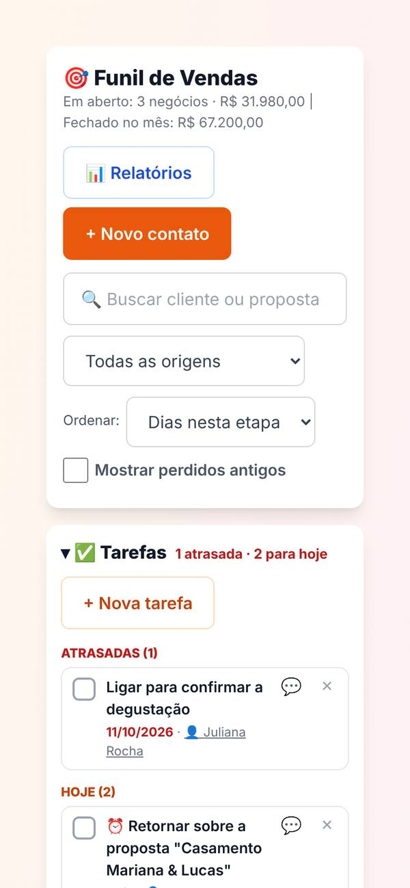

### 6.1 Etapas

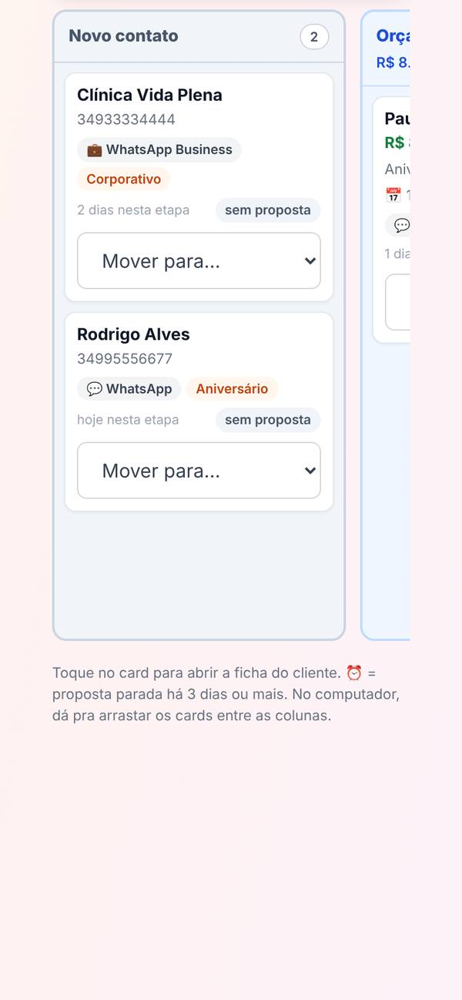

- **Novo contato:** clientes que ainda não têm proposta.
- **Orçamento:** proposta em rascunho.
- **Proposta enviada:** proposta marcada como "Enviada".
- **Fechado:** proposta "Aprovada".
- **Perdido:** proposta "Rejeitada" ou contato que não fechou.

Cada cartão é uma proposta. Ele mostra o cliente, a data do evento, os convidados, o valor e há quantos dias está na etapa. Um mesmo cliente pode ter vários negócios ao mesmo tempo (por exemplo, um casamento fechado e um aniversário em orçamento).

### 6.2 Mover um negócio de etapa

- No computador, arraste o cartão para outra coluna.
- No celular (ou no computador), use o menu **"Mover para…"** do cartão.

A etapa e o status da proposta andam juntos:

| Etapa no Funil | Status da proposta |
|---|---|
| Proposta enviada | Enviada |
| Fechado | Aprovada |
| Perdido | Rejeitada |

Mudar o status na aba Propostas também move o cartão.

### 6.3 Marcar como perdido

Ao mover para "Perdido", o sistema pergunta o motivo: Preço, Data ocupada, Fechou com outro fornecedor, Desistiu do evento, Sem resposta ou Outro. Você pode escrever um detalhe opcional. O motivo aparece no cartão, na ficha do cliente e nos Relatórios.

Perdidos com mais de 60 dias ficam escondidos. Marque **"Mostrar perdidos antigos"** para vê-los.

### 6.4 Novo contato

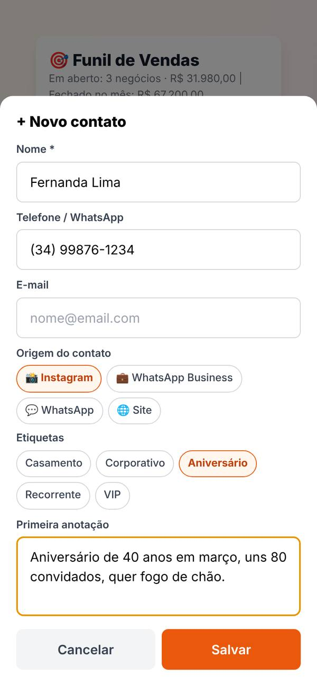

1. Toque em **"+ Novo contato"**.
2. Preencha nome, telefone/WhatsApp e e-mail.
3. Escolha a **origem do contato**: Instagram, WhatsApp Business, WhatsApp ou Site.
4. Escolha as **etiquetas**: Casamento, Corporativo, Aniversário, Recorrente ou VIP.
5. Se quiser, escreva uma **primeira anotação**.
6. Toque em **"Salvar"**.

O contato entra na coluna "Novo contato". Quando você criar uma proposta para ele, o negócio passa a aparecer como proposta.

> **Exemplo:** uma pessoa chamou no Instagram perguntando preço para um aniversário. Crie o contato "Fernanda Lima", origem **Instagram**, etiqueta **Aniversário**, e anote: "Aniversário de 40 anos em março, uns 80 convidados, quer fogo de chão." Depois os Relatórios mostram quantas vendas vieram do Instagram.

### 6.5 Buscar, filtrar e ordenar

- **Buscar:** procura por cliente, proposta ou etiqueta.
- **Origem:** mostra só os contatos de uma origem.
- **Ordenar:** por "Dias nesta etapa" (os parados há mais tempo primeiro) ou por "Data do evento" (o evento mais próximo primeiro). A escolha fica gravada.
- **Resumo:** o topo mostra quantos negócios estão em aberto, o valor em aberto e o valor fechado no mês.

### 6.6 Proposta parada

Uma proposta enviada há 3 dias ou mais fica com a contagem de dias destacada em laranja. O sistema também cria uma tarefa de retorno sozinho (veja o capítulo 8).

---

## 7. Ficha do cliente

A ficha reúne tudo sobre um cliente. Para abrir:

- toque em um cartão no **Funil**; ou
- use o botão **"Ficha"** na aba **Clientes**.

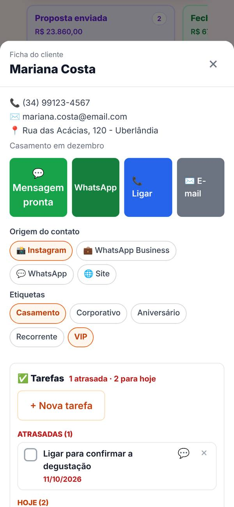

### 7.1 O que tem na ficha

- **Atalhos:** **💬 Mensagem pronta** (capítulo 9), WhatsApp, Ligar e E-mail.
- **Origem e etiquetas:** podem ser alteradas na própria ficha.
- **Negócios:** as propostas do cliente, com etapa e valor. Use "Ver" para abrir a proposta.
- **Tarefas do cliente:** as tarefas ligadas a ele, com o botão "+ Nova tarefa".
- **Linha do tempo:** o histórico do relacionamento.

Para um contato sem proposta, a ficha permite **"Marcar como perdido"** ou **"Voltar para Novo contato"**. Para mudar a etapa de uma proposta, use o menu "Mover para…" no Funil.

### 7.2 Linha do tempo

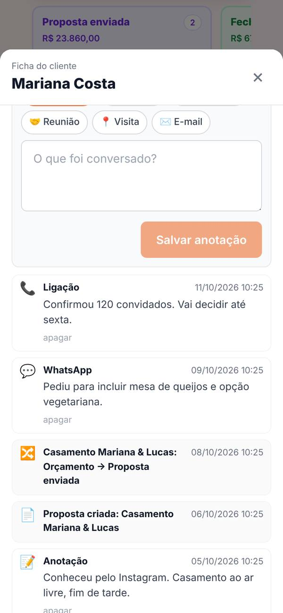

1. Escolha o tipo: Anotação, Ligação, WhatsApp, Reunião, Visita ou E-mail.
2. Escreva o que foi conversado.
3. Toque em **"Salvar anotação"**.

O sistema registra sozinho as mudanças de etapa (com o motivo da perda, quando houver), as propostas criadas, as tarefas concluídas e as mensagens prontas enviadas. Anotações podem ser apagadas.

> **Exemplo:** depois de ligar para a cliente, escolha **Ligação** e escreva "Confirmou 120 convidados. Vai decidir até sexta." Na próxima conversa, você sabe exatamente onde parou.

---

## 8. Tarefas e lembretes

As tarefas aparecem no **Funil**, na **ficha do cliente** e na **Agenda**.

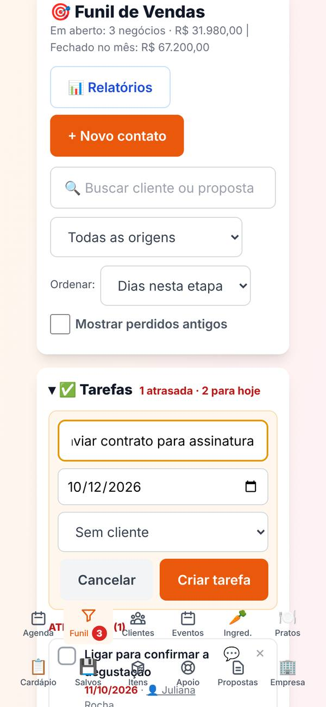

### 8.1 Criar uma tarefa

1. Toque em **"+ Nova tarefa"**.
2. Escreva o que precisa ser feito.
3. Escolha a data e o cliente. Os dois são opcionais.
4. Toque em **"Criar tarefa"**.

> **Exemplo:** "Enviar contrato para assinatura", data 10/12, cliente Mariana Costa. No dia 10 ela aparece em **Hoje** e na Agenda.

### 8.2 Acompanhar

- As tarefas ficam separadas em **Atrasadas**, **Hoje**, **Próximas** e **Sem data**.
- A aba **Funil** mostra um número com as tarefas atrasadas e de hoje.
- Marque a caixinha para concluir. A tarefa concluída entra na linha do tempo do cliente.
- O **💬** ao lado da tarefa abre a mensagem pronta certa para ela (capítulo 9).
- O **×** apaga a tarefa.

### 8.3 Tarefas automáticas

O sistema cria sozinho estas tarefas, sem repetir para a mesma proposta:

| Quando | Tarefa criada | Mensagem pronta sugerida |
|---|---|---|
| Proposta "Enviada" há 3 dias sem mudança | Retornar sobre a proposta | Retorno da proposta |
| Dia seguinte a um evento de proposta aprovada | Agradecer e pedir avaliação | Agradecimento e avaliação (ou Agradecimento, se não houver link de avaliação) |
| Quase um ano depois do evento | Recontatar para o próximo evento | Recontato |

A tarefa de retorno fecha sozinha quando a proposta muda de status ou é excluída. A tarefa de agradecimento só é criada para eventos dos últimos 7 dias, para não aparecerem tarefas de eventos antigos.

### 8.4 Lembretes

Os lembretes aparecem só dentro do aplicativo: no contador, nas listas e na Agenda. O sistema não envia notificações para o celular nem e-mails.

---

## 9. Mensagens prontas para WhatsApp

A mensagem pronta abre o WhatsApp com o texto já escrito, preenchido com os dados do cliente e da proposta.

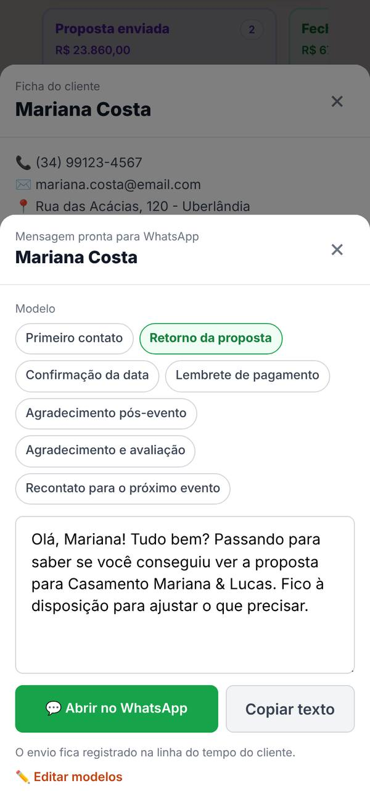

### 9.1 Onde fica

- **Ficha do cliente:** botão **"💬 Mensagem pronta"**. Aparece quando o cliente tem telefone.
- **Tarefas:** o **💬** ao lado da tarefa já abre o modelo certo para ela.
- **Propostas:** botão **"💬 WhatsApp"** no cartão da proposta. Funciona também sem o Funil (plano Standard).

### 9.2 Como enviar

1. Abra a mensagem pronta por um dos botões acima.
2. Escolha o **modelo**. O texto aparece preenchido.
3. Se quiser, ajuste o texto ali mesmo.
4. Toque em **"💬 Abrir no WhatsApp"** e envie a mensagem pelo WhatsApp. Também dá para usar **"Copiar texto"**.

Com o Funil (Premium), o envio fica registrado na linha do tempo do cliente como "WhatsApp".

**Enviar direto pelo número da empresa (Premium, com o WhatsApp configurado no painel da empresa):** o botão **"📤 Enviar pelo WhatsApp"** manda a mensagem sem abrir o seu WhatsApp. A Meta só entrega texto livre para quem falou com você nas **últimas 24 h**. Para os outros clientes:

1. Crie e aprove os modelos de mensagem no WhatsApp Manager da Meta.
2. Em **"✏️ Editar modelos"**, no quadro **"📲 Modelos da Meta"**, toque em **"Ligar pelos nomes"** (ou escolha o modelo em cada mensagem) e confira as variáveis: cada {{1}}, {{2}}… do modelo recebe um dado do app ({primeiro_nome}, {evento}, {data}…).
3. Toque em **"Salvar ligações"**.

Mensagem ligada a modelo: o envio direto manda sempre o **modelo aprovado** com os dados preenchidos, e ele chega mesmo para quem não falou com você nas últimas 24 h. Vai o texto aprovado na Meta, não o texto editado na tela. Mensagem sem modelo vai como texto livre: a Meta aceita, mas **só entrega** se o cliente falou com você nas últimas 24 h. Mensagens sem modelo ligado continuam com **"💬 Abrir no app"**. Precisa do **WhatsApp Business Account ID** preenchido no painel da empresa > WhatsApp.

### 9.3 Modelos que já vêm prontos

- **Primeiro contato:** para responder um pedido de orçamento.
- **Retorno da proposta:** para quem não respondeu.
- **Confirmação da data.**
- **Lembrete de pagamento.**
- **Agradecimento pós-evento.**
- **Agradecimento e avaliação:** inclui o link de avaliação do Google.
- **Recontato para o próximo evento.**

> **Exemplo de texto preenchido:** "Olá, Mariana! Tudo bem? Passando para saber se você conseguiu ver a proposta para Casamento Mariana & Lucas. Fico à disposição para ajustar o que precisar."

### 9.4 Editar os modelos

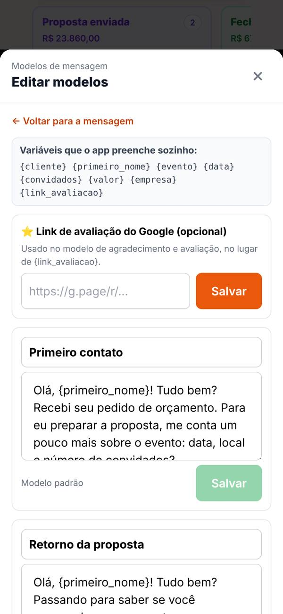

1. Na janela da mensagem, toque em **"✏️ Editar modelos"**.
2. Mude o nome ou o texto de qualquer modelo e toque em **"Salvar"**.
3. **"Restaurar"** volta um modelo ao texto original.
4. **"+ Novo modelo"** cria um modelo seu. Modelos criados por você podem ser apagados.
5. Toque em **"← Voltar para a mensagem"** para usar o modelo.

Os modelos ficam salvos na sua conta e valem em todos os aparelhos.

**Variáveis que o app preenche sozinho:**

| Variável | Vira | Exemplo |
|---|---|---|
| {cliente} | nome completo do cliente | Mariana Costa |
| {primeiro_nome} | primeiro nome | Mariana |
| {evento} | nome da proposta | Casamento Mariana & Lucas |
| {data} | data do evento | 25/10/2026 |
| {convidados} | número de convidados | 120 |
| {valor} | valor da proposta | R$ 18.960,00 |
| {empresa} | nome da sua empresa | Buffet Sabor & Brasa |
| {link_avaliacao} | seu link de avaliação do Google | (o link que você cadastrar) |

Quando uma informação não existe (por exemplo, um contato sem proposta não tem {valor}), ela é tirada do texto. Antes de enviar, confira se a frase continua fazendo sentido.

### 9.5 Link de avaliação do Google

No campo **"⭐ Link de avaliação do Google (opcional)"** cole o link que o Google dá para os clientes avaliarem a sua empresa. Ele entra no lugar de {link_avaliacao}.

> **Como pegar o link:** no Google, procure o nome da sua empresa e, no seu Perfil da Empresa, toque em **"Pedir avaliações"** (ou "Compartilhar formulário de avaliação"). Copie o link e cole aqui.

---

## 10. Relatórios (Premium)

No topo do Funil, toque em **"📊 Relatórios"**. Para voltar, toque em **"← Voltar para o funil"**.

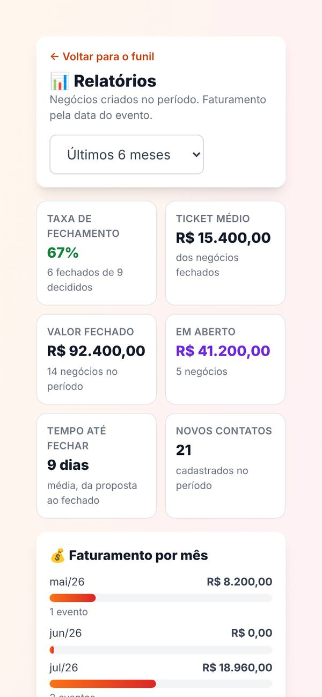

Escolha o período: últimos 30 dias, 3, 6 ou 12 meses, ou este ano. A escolha fica gravada.

**Cartões:**

- **Taxa de fechamento:** fechados ÷ (fechados + perdidos).
- **Ticket médio:** valor médio dos negócios fechados.
- **Valor fechado** e **Em aberto.**
- **Tempo até fechar:** média de dias da proposta até o "Fechado".
- **Novos contatos** cadastrados no período.

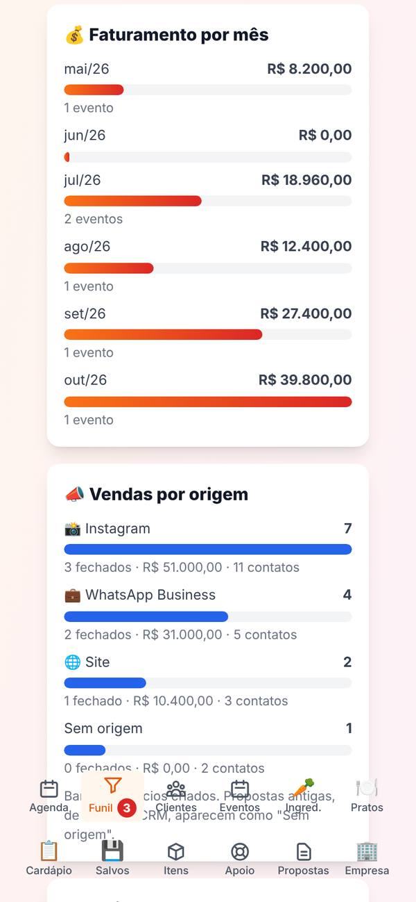

**Gráficos:**

- **Faturamento por mês:** pela data do evento, só negócios fechados.
- **Vendas por origem:** quantos negócios, quantos fechados e quanto vendeu cada origem (Instagram, WhatsApp, Site…).
- **Motivos de perda:** por que os negócios não fecharam.

Os negócios contados são os criados no período escolhido.

> **Exemplo de leitura:** se o Instagram trouxe 7 negócios e fechou 3, e o WhatsApp Business trouxe 4 e fechou 2, os dois canais fecham parecido. Se "Preço" é o motivo de perda que mais aparece, vale revisar a margem ou oferecer um cardápio mais enxuto.

Para os relatórios ficarem certos, preencha a **origem** dos contatos e o **motivo** quando perder um negócio.

---

## 11. Clientes

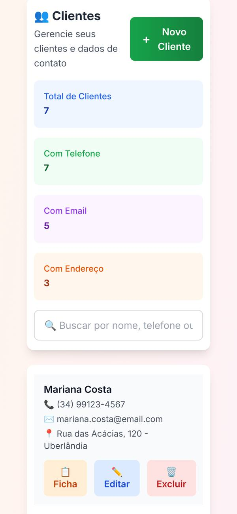

### 11.1 Cadastrar

1. Toque em **"Novo Cliente"**.
2. Preencha nome (obrigatório), telefone, e-mail, endereço e observações.
3. Toque em **"Salvar"**.

### 11.2 Outras ações

- **Buscar:** por nome, telefone ou e-mail.
- **Ficha:** abre a ficha do cliente (Premium).
- **Editar** e **Excluir**.

O topo da tela mostra o total de clientes e quantos têm telefone, e-mail e endereço.

> **Dica:** cadastre o telefone com DDD, por exemplo (34) 99123-4567. Assim os botões de WhatsApp e a mensagem pronta funcionam.

---

## 12. Ingredientes

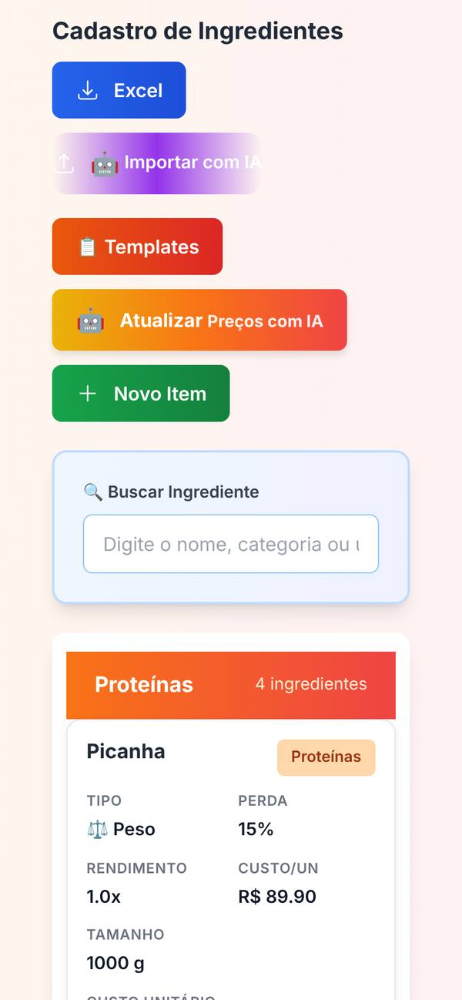

### 12.1 Cadastrar um ingrediente

1. Toque em **"Novo Item"**.
2. Preencha:
   - **Nome** e **Categoria** (Proteínas, Carboidratos, Vegetais, Laticínios, Gorduras, Temperos, Bebidas, Sobremesas, Outros).
   - **Tipo de venda:** por peso (kg, g, L, ml) ou por unidade (pão, ovo, lata).
   - **Perda (%):** o que se perde no preparo (limpeza, osso, gordura).
   - **Rendimento (x):** quanto o ingrediente cresce no preparo (arroz 3,0x, massa 2,5x, padrão 1,0x).
   - **Custo da embalagem** e **quantidade na embalagem** (ou tamanho da unidade, em g ou ml).
3. O sistema mostra o custo por grama ou por unidade.
4. Toque em **"Salvar"**.

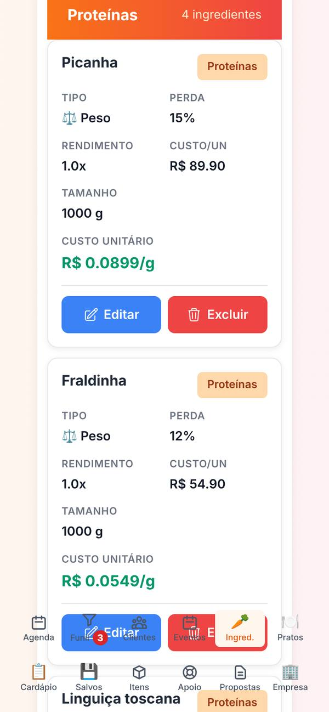

> **Exemplo:** picanha comprada a R$ 89,90 o kg, com 15% de perda na limpeza. Cadastre: tipo **peso**, embalagem **1000 g**, custo **89,90**, perda **15**. O sistema calcula R$ 0,0899 por grama e, nos pratos, já compra 15% a mais para compensar a perda.

> **Peso e volume são sempre por 1 kg / 1 L:** o tamanho da unidade fica em **1000 g (ou ml)**. Se você comprar em pacote menor, pode digitar o pacote (ex.: manteiga, 500 g por R$ 12): ao salvar, o sistema converte para **1000 g por R$ 24**, o mesmo custo por grama.

### 12.2 Outras ações

- **Buscar:** por nome, categoria ou unidade.
- **Editar** e **Excluir.** A coluna "Em Uso" mostra se o ingrediente está no evento atual.
- **Excel:** exporta todos os ingredientes para planilha.

### 12.3 Recursos com IA (Premium)

- **Importar com IA:** envie uma lista de preços em PDF, foto (JPG, PNG, GIF, WebP), planilha (XLS, XLSX, CSV) ou texto. A IA lê nome, preço, unidade e categoria. Ela cria os ingredientes novos e atualiza os preços que mudaram.
- **Templates:** adiciona listas prontas de ingredientes. Os que você já tem não são duplicados.
- **Atualizar Preços com IA:** estima o preço dos ingredientes que estão sem preço.

Os preços estimados pela IA são uma referência. Confirme sempre com seus fornecedores.

---

## 13. Pratos

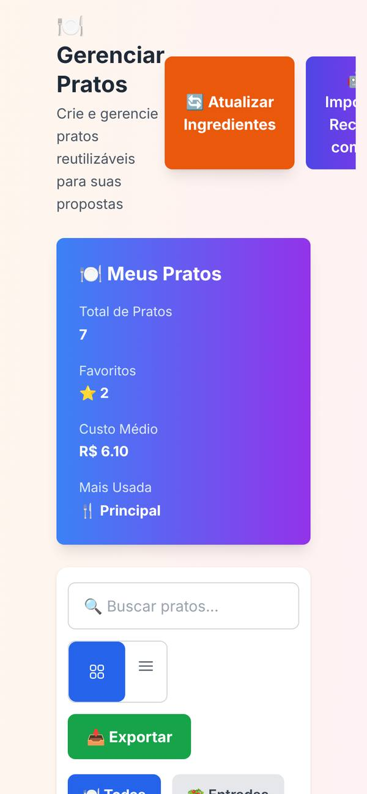

### 13.1 Criar um prato

1. Toque em **"Novo Prato"**.
2. Preencha nome, descrição, categoria (Entrada, Prato Principal, Acompanhamento, Sobremesa, Bebida, Outro) e o **número de porções** que o prato rende.
3. Escolha o cálculo: **por porção** (marcado) ou **por peso, em R$ por 100 g** (desmarcado).
4. Toque em **"Adicionar Ingrediente"**, escolha o ingrediente e informe a **quantidade comprada (bruta)**, antes de limpar ou cozinhar.
5. Marque **"Descartável após uso"** para itens como sal, açúcar ou vinho de marinada. Eles contam no custo, mas não no peso final.
6. Defina o **markup (%)**, ou seja, quanto somar ao custo. O preço sugerido aparece por porção ou por 100 g. Embaixo aparecem a **margem real** e o **CMV** (custo ÷ preço). O CMV fica vermelho acima de 40%.
7. Se quiser, adicione até 3 fotos, observações e a ficha técnica (tempo, temperatura, equipamentos).
8. **Vendas (Premium):** marque **"🧾 Vender este prato"** para vendê-lo na aba Vendas, com preço de venda, categoria e estoque de prontos (veja 22.1).
9. Toque em **"Criar Prato"**.

O resumo mostra o custo total e o peso final depois da perda dos ingredientes. A perda **não** aumenta o custo: ela diminui o peso final, e por isso o custo por 100 g e por porção sobe na medida certa.

> **Exemplo de custo:** costela, 3 kg comprados a R$ 34,90/kg, com 40% de perda (osso e gordura):
> - custo = 3 × 34,90 = **R$ 104,70**;
> - peso final = 3.000 g × 60% = **1.800 g**;
> - custo por 100 g = **R$ 5,82**.

> **Markup × margem:** um prato que custa R$ 10,00 por porção:
> - com markup de **100%**, é vendido por R$ 20,00 (margem real 50%, CMV 50%);
> - com markup de **300%**, por R$ 40,00 (margem real 75%, CMV 25%).

### 13.2 Outras ações

- **Adicionar ao Cardápio:** coloca o prato no cardápio do evento atual.
- **Atualizar Ingredientes:** atualiza os preços de todos os pratos e cardápios salvos com os valores atuais da aba Ingredientes. Use depois de mudar preços.
- **Importar Receita com IA (Premium):** cole uma receita de qualquer fonte. A IA identifica os ingredientes e as quantidades e mostra quais já estão cadastrados. Ela também estima os preços que faltam, para você revisar, e cria o prato.
  - **Pedir à IA:** na mesma janela, abra a aba **🔎 Pedir à IA**, diga o prato (ex.: "Costela no bafo"), quantas porções deve render e, se quiser, observações (sem lactose, custo baixo…). Com **Buscar receitas na internet** marcado, a IA pesquisa em sites de culinária e mostra as fontes. Confira a sugestão e toque em **Usar esta receita**: os ingredientes são ligados à sua base como na receita colada, e o prato é criado já com o rendimento e o modo de preparo na ficha técnica. Se não gostar, peça **Outra sugestão**.

---

## 14. Cardápio do evento

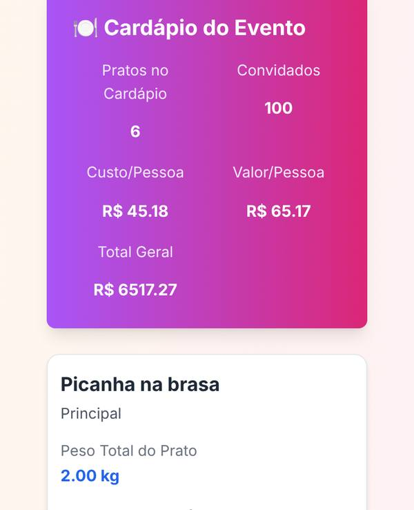

1. Na aba **Pratos**, toque em **"Adicionar ao Cardápio"** nos pratos desejados.
2. Na aba **Cardápio**, ajuste as **porções por pessoa** de cada prato. Nos pratos vendidos por peso, 1 porção = 100 g. Por exemplo, 2,5 porções = 250 g por pessoa.
3. Confira o custo por pessoa, o valor por pessoa e o total geral.
4. Toque em **"Gerar Lista de Compras"** para enviar os ingredientes para a aba Itens.
5. Toque em **"Salvar Cardápio"**, dê um nome, escolha o tipo de evento e, se quiser, escreva uma descrição. Se já existir um cardápio com o mesmo nome, o sistema pergunta se deve sobrescrever.

**Montar com IA (Premium):** informe preferências (por exemplo: churrasco argentino, sem lactose, vegetariano) e toque em "Gerar Cardápio". Os pratos que você ainda não tem são criados sozinhos, com receita e custo, antes de entrar no cardápio.

Use **"Limpar"** para esvaziar o cardápio.

**Atualizar pratos:** o cardápio guarda uma cópia de cada prato. Se você editar um prato depois (ingredientes, rendimento, margem ou nome), toque em **"Atualizar pratos"** para trazer os dados atuais. As porções por pessoa continuam as mesmas. Se a lista de compras já tiver sido gerada, o app pergunta se você quer gerar de novo. Pratos excluídos do cadastro ficam como estavam, e o app avisa quais são.

> **Exemplo:** para 100 convidados, com picanha a 250 g por pessoa, o sistema calcula 25 kg servidos. Na aba Itens, a quantidade a comprar já inclui a perda da limpeza.

---

## 15. Cardápios salvos

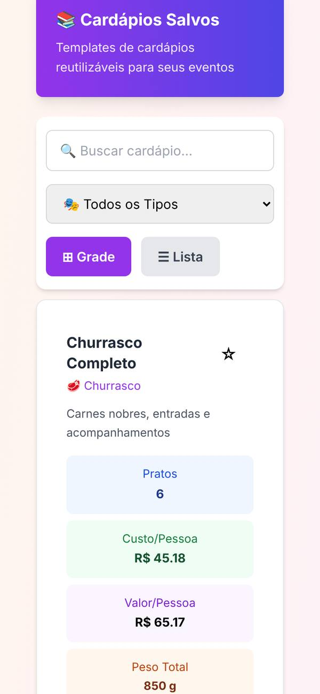

A aba **Salvos** guarda seus cardápios para reutilizar.

- Busque pelo nome e filtre por tipo de evento (Casamento, Corporativo, Aniversário, Formatura, Churrasco, Festa, Outro).
- Alterne entre visualização em **Grade** e em **Lista**.
- Ações de cada cardápio:
  - **Visualizar**;
  - **gerar lista de compras**;
  - **carregar no evento atual**;
  - **atualizar os pratos** (🔄);
  - **duplicar**;
  - **excluir**.
- **Atualizar pratos de todos** (no topo) traz os dados atuais dos pratos para todos os cardápios salvos, mantendo as porções por pessoa de cada um. O app avisa quais cardápios mudaram.

> **Dica:** monte cardápios-base ("Churrasco Completo", "Coquetel Corporativo") e use **duplicar** para criar variações para cada cliente.

---

## 16. Itens (lista de compras)

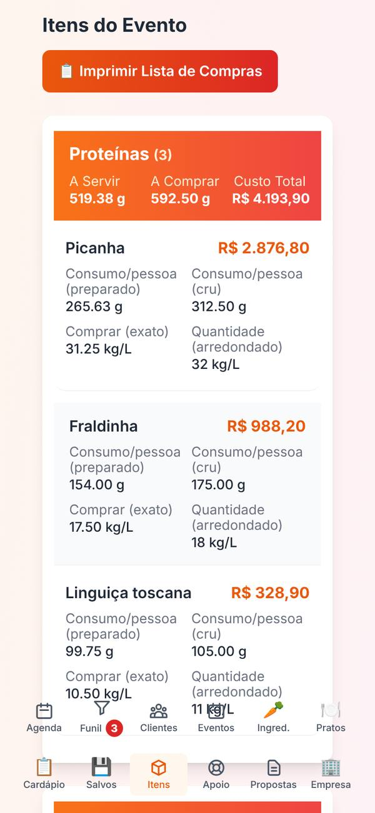

A aba **Itens** mostra os ingredientes do evento calculados para o número de convidados:

- **A Servir:** quantidade pronta, depois do preparo.
- **A Comprar:** quantidade crua, já considerando perda e rendimento.
- **Comprar (pela embalagem):** a quantidade exata arredondada para cima pelo tamanho da embalagem cadastrada no ingrediente. Por exemplo, 30 g de pimenta → 1 embalagem de 100 g.
- **Custo Total** de cada item: o custo do que é **usado** no evento. A sobra da embalagem não entra no preço do evento.

Use **"Imprimir Lista de Compras"** para levar ao fornecedor ou ao mercado.

No plano Premium, o quadro **"Estoque deste evento"** fica no topo da aba (veja o capítulo 21).

### 16.1 Insumos do cliente

Use quando o cliente compra os insumos (todos ou parte) e você cobra o preparo, a mão de obra, o apoio e o transporte.

1. Monte o cardápio e gere a lista de compras.
2. No topo da aba **Itens**, marque **"🧺 O cliente fornece insumos neste evento"**.
3. Marque o que o cliente compra:
   - a **categoria inteira** (ex.: Proteínas);
   - ou só alguns itens, em **"escolher itens"**.
4. Se quiser, informe a **taxa de preparo por convidado** (R$). Ela entra no preço do evento e da proposta.
5. Toque em **"📋 Lista de compras do cliente"** para imprimir ou enviar a lista do cliente, com as quantidades já com a perda no preparo.

O que o cliente compra:

- sai do custo do evento e do preço dos pratos (essa parte do cardápio com a sua margem), e também da margem de segurança das proteínas;
- aparece na lista com a etiqueta **"🧺 cliente compra"** e não entra na sua lista de compras impressa;
- não sai do estoque e não entra na compra sugerida.

O **Resumo** mostra a **taxa de preparo** e quanto ficou de **insumos do cliente** (fora do preço).

Itens de apoio que o cliente traz (carvão, gelo, descartáveis): marque **"🧺 O cliente traz este item"** no item, na aba Apoio (capítulo 17).

> **Exemplo:** churrasco para 100 pessoas em que o cliente compra todas as carnes. Marque **Proteínas** e uma taxa de preparo de R$ 15,00 por convidado. As carnes saem do custo e do preço, entram R$ 1.500,00 de taxa de preparo, e o cliente recebe a lista: Picanha 36 kg, Fraldinha 21 kg e Linguiça toscana 13 kg.

---

## 17. Apoio, transporte e mão de obra

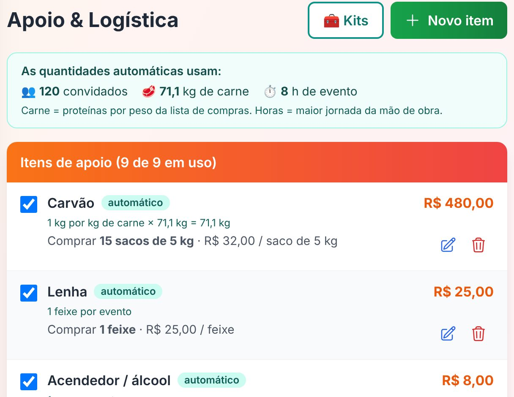

Tudo fica na aba **Apoio** e entra no custo do evento.

- **Apoio e logística:** a lista de itens do evento (carvão, gelo, guardanapos, pratos, copos…). Desmarque a caixinha para tirar um item do evento sem apagá-lo. Veja abaixo como deixar as quantidades automáticas.
- **Transporte e pedágio:** marque "Ativo" e informe:
  - distância de ida (km);
  - consumo (km/l);
  - preço do combustível;
  - **pedágio por viagem (ida + volta)**;
  - número de viagens.
- **Mão de obra:** para um cálculo simples, informe horas e valor/hora. Para uma equipe, toque em **"👥 Montar equipe"** e cadastre cada função: pessoas, horas, R$/hora e encargos (%). Para diária, use 1 hora e o valor da diária.

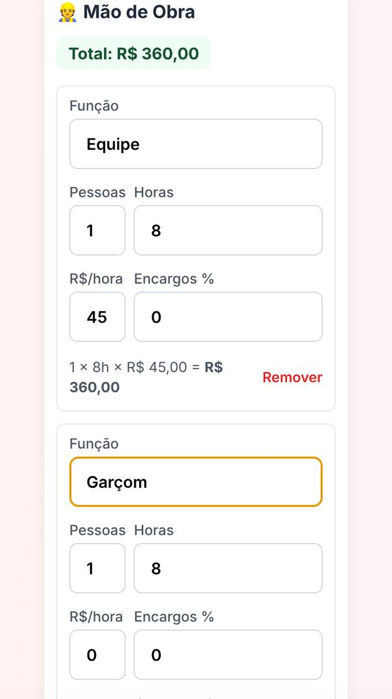

> **Exemplo de equipe:** 4 garçons × 6 h × R$ 25 + 20% de encargos = R$ 720; 2 churrasqueiros × 8 h × R$ 40 = R$ 640. Total da mão de obra: **R$ 1.360**.

### 17.1 Quantidade automática

Toque no lápis de um item (ou em **"Novo item"**) e escolha **"Como calcular a quantidade"**:

| Regra | Exemplo |
|---|---|
| Por convidado | 4 guardanapos por convidado |
| A cada X convidados | 1 churrasqueiro a cada 30 convidados (100 convidados = 4) |
| Por kg de carne | 1 kg de carvão por kg de carne |
| Por hora de evento | 2 kg de gelo por hora |
| Fixo por evento | 2 rolos de papel alumínio |
| Quantidade manual | você digita a quantidade (como antes) |

O quadro verde no topo mostra a base do cálculo:

- **Convidados:** os do evento.
- **Kg de carne:** as proteínas por peso da lista de compras. Gere a lista pelo cardápio (aba Cardápio → Gerar lista de compras) para o carvão ser calculado.
- **Horas:** a maior jornada da mão de obra.

Mudou o número de convidados ou o cardápio? As quantidades se ajustam sozinhas.

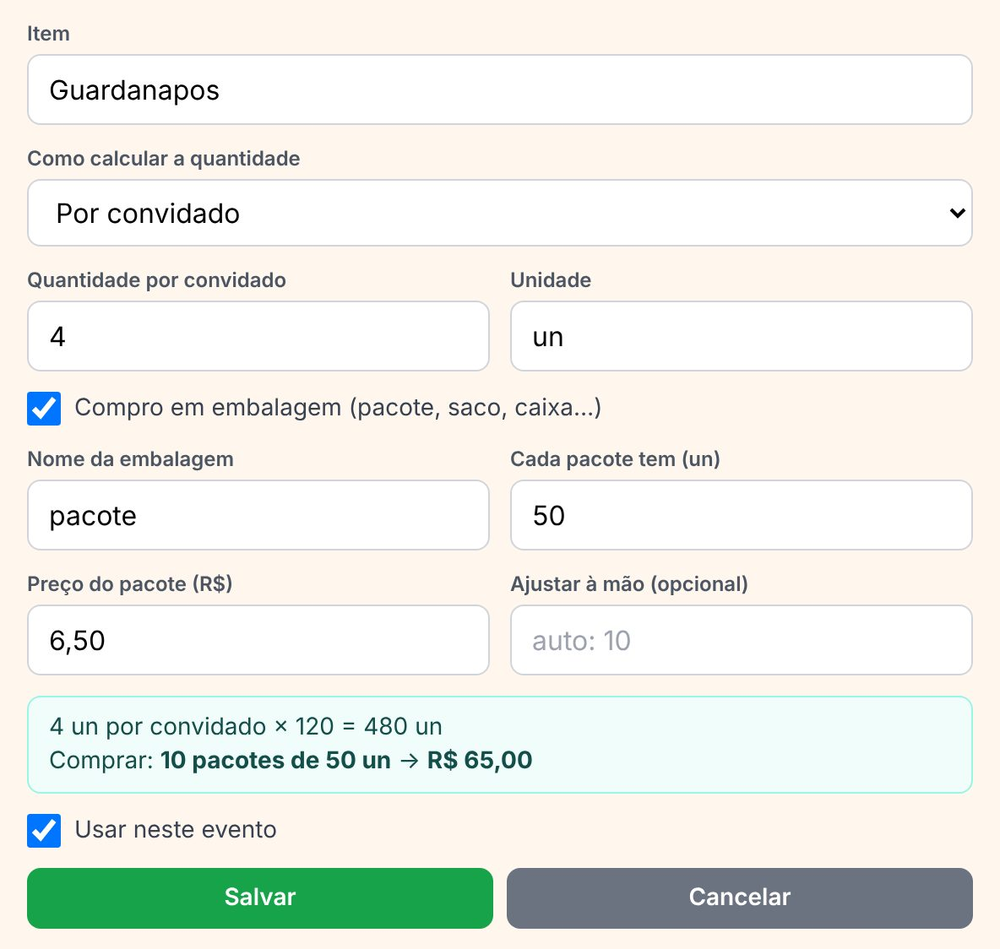

**Embalagem:** marque **"Compro em embalagem"** e informe o nome (pacote, saco, caixa) e quantas unidades vêm em cada uma. O preço passa a ser o **da embalagem**, e o app arredonda para embalagens inteiras.

**Ajustar à mão:** precisa de outra quantidade só neste evento? Preencha **"Ajustar à mão"**. O item fica marcado como **ajustado à mão** e não muda mais sozinho. Para voltar, toque em **↺ voltar ao automático**.

Avisos na lista:

- **sem preço:** o item está sem preço e não entra no custo.
- **confira o preço:** o preço veio de um item antigo e pode ser da unidade, e não da embalagem. Abra o item e confira.

> **Exemplo:** 120 convidados e 71,1 kg de carne. Guardanapos: 4 por convidado = 480 un → **10 pacotes de 50** a R$ 6,50 = R$ 65,00. Carvão: 1 kg por kg de carne = 71,1 kg → **15 sacos de 5 kg** a R$ 32,00 = R$ 480,00.

### 17.2 Kits

Toque em **🧰 Kits** para montar a lista de uma vez:

- **Kits sugeridos:** Churrasco completo, Coquetel / finger food e Só serviço de churrasqueiro. As quantidades são sugestões; ajuste para a sua realidade.
- **Seus kits:** monte a lista do seu jeito, escreva um nome em **"Salvar a lista atual como kit"** e toque em **Salvar kit**. Entram os itens marcados, com regra, embalagem e preço. O kit fica salvo na sua conta e aparece em todos os aparelhos.

Ao aplicar um kit, os preços que você já tem são mantidos. Os itens que não estão no kit ficam na lista, desmarcados.

### 17.3 Apoio que o cliente traz

Com **"O cliente fornece insumos"** ligado na aba Itens (capítulo 16.1), o editor do item de apoio ganha **"🧺 O cliente traz este item"**. O item fica com a etiqueta **"o cliente traz"**: sai do custo e do preço, não sai do estoque e entra na lista do cliente.

---

## 18. Eventos

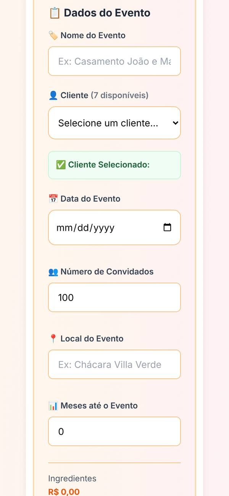

### 18.1 Dados do evento

1. Na aba **Eventos**, preencha o nome do evento.
2. Escolha o **cliente** (cadastre antes na aba Clientes).
3. Informe a data, o número de convidados e o local.
4. Em **"Meses até o Evento"**, informe quantos meses faltam. O sistema corrige **comida e apoio** pela correção mensal de "Custos da empresa" (padrão 1% ao mês). Mão de obra e transporte não são corrigidos.
5. Em **"🥩 Margem de segurança das proteínas (%)"**, deixe vazio para usar o padrão de Custos da empresa (15%) ou digite outro valor só para este evento (ex.: 20% num casamento grande, 0% num jantar com número fechado).
6. Confira os totais: ingredientes, apoio, transporte, mão de obra, total, total dos pratos e total com margem.
7. Toque em **"Salvar Evento"**.

> 🥩 **Como funciona a margem de segurança:** vale para os ingredientes da categoria **Proteínas** (carnes, frango, peixe, linguiça). A conta aplica primeiro a perda e depois a margem. Exemplo com 120 convidados, 400 g por pessoa e 20% de perda: 60 kg → com 15% de margem, **69 kg** na lista de compras. A carne extra entra no custo, nos totais e na proposta, então a sobra não sai do seu lucro. No Resumo aparece a linha "Margem de segurança das proteínas (já incluída)" e, na aba Itens, as proteínas mostram o selo **+15% segurança**.

### 18.2 Eventos salvos

- Busque pelo nome e ordene por mais recente, mais antigo, data do evento ou nome.
- **Carregar:** abre o evento salvo (os dados atuais são substituídos).
- **Excluir:** remove o evento.
- **Novo Evento:** começa um evento em branco: limpa o cardápio, os itens, o cliente e os dados do evento. Apoio, mão de obra e transporte ficam, para aproveitar nos próximos eventos.

### 18.3 Margens do evento

No **Resumo Financeiro**, o quadro **📊 Margens do evento** mostra quanto sobra do preço de venda, em reais e em %. O preço de venda é o mesmo da proposta: o total com margem (ou o total dos pratos, sem cardápio com margem) ou o preço pelo método do divisor, se ele for o padrão em Custos da empresa.

- **Margem bruta** = preço − comida − apoio.
- **Margem operacional** = bruta − mão de obra − transporte − taxas de cartão − custos fixos.
- **Margem líquida** = operacional − impostos. É o lucro estimado da proposta.

Toque em **"Ver a conta"** para ver cada valor descontado. As taxas, os custos fixos e os impostos vêm dos percentuais de **Custos da empresa**; sem eles, a operacional e a líquida aparecem maiores do que são (o quadro avisa).

> **Exemplo:** preço de R$ 10.000, comida e apoio R$ 3.800 → margem bruta 62%. Menos mão de obra R$ 1.500, transporte R$ 300, taxas R$ 300 e custos fixos R$ 1.000 → operacional 31%. Menos impostos de R$ 600 → líquida 25%.

---

## 19. Propostas

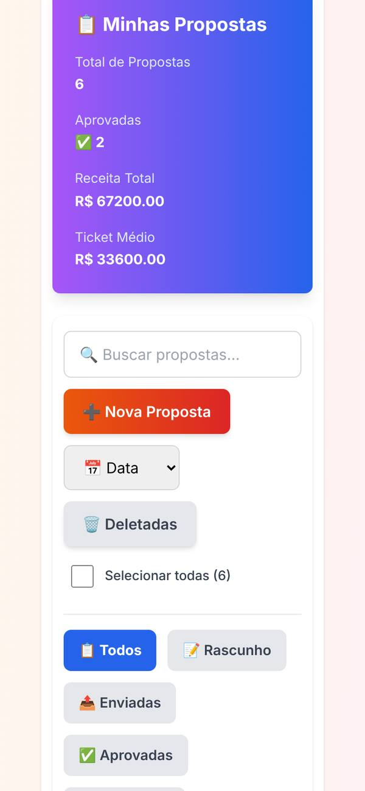

### 19.1 Criar uma proposta

1. Na aba **Propostas**, toque em **"Nova Proposta"**.
2. Dê um nome à proposta. Por exemplo: "Casamento Mariana & Lucas". O nome aparece nas mensagens prontas como {evento}.
3. Confira o **cardápio**. A proposta nova já vem com o cardápio do evento aberto (aba Cardápio). Para usar outro, remova e escolha um **cardápio salvo**.
4. Escolha qual total usar para a comida:
   - **Pratos + markup** (recomendado e padrão);
   - pratos só pelo custo;
   - lista de compras do evento.
5. Confira o cliente, a data, os convidados e o local.
6. Preencha:
   - observações;
   - validade (dias);
   - forma de pagamento;
   - confirmação mínima (dias);
   - formas aceitas (dinheiro, cartão, PIX).
7. Escolha quais dados da empresa aparecem: nome, contatos, história, missão, visão, valores, motivação e fotos.
8. Confira o **Preço da proposta** (veja 19.2). Se quiser, use o **ajuste final (%)** para dar desconto (número negativo) ou acréscimo.
9. Escolha se as fotos dos pratos aparecem no cardápio.
10. Toque em **"Salvar Proposta"**.

### 19.2 Preço da proposta

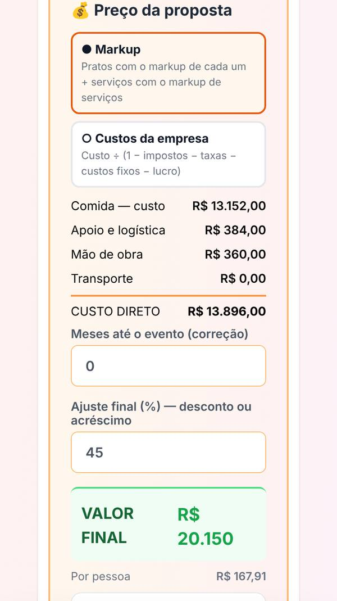

O preço é calculado com o **cardápio escolhido** e os **convidados da própria proposta**. Mudou os convidados, o valor muda junto. Há dois modos:

- **Markup:** comida com o markup de cada prato, mais apoio, mão de obra e transporte com o "markup sobre serviços" de Custos da empresa.
- **Custos da empresa:** preço = custo direto ÷ (1 − impostos − taxas − custos fixos − lucro), com os percentuais de Custos da empresa (capítulo 4.1).

O quadro mostra:

- custo da comida, apoio, mão de obra e transporte;
- a correção até o evento, calculada pela data;
- a **margem de segurança das proteínas** já incluída no custo (o % pode ser mudado na própria proposta; vem do evento ou de Custos da empresa). Propostas feitas antes desta opção continuam sem a margem;
- o **custo direto** e o **valor final**;
- o **lucro estimado** (já descontando impostos, taxas e custos fixos), o markup sobre o custo e o CMV.

Avisos:

- **Proposta SEM LUCRO:** o valor final não cobre o custo. O sistema pede confirmação antes de salvar.
- **Margem sobre margem:** os pratos já têm markup e o ajuste final soma mais em cima.

**Editar uma proposta** mantém os convidados, os custos e as regras dela, mesmo que o evento aberto na aba Eventos seja outro. Propostas antigas, sem os números do cardápio, mantêm o valor gravado. Para recalcular uma delas, remova o cardápio e selecione de novo.

**Mudou o evento depois de fazer a proposta?** Abra o evento na aba Eventos, edite a proposta e toque em **🔄 Puxar dados do evento** (no quadro Dados do Evento). Aparece o que muda (convidados, data, local, cliente, apoio, mão de obra, transporte) e o valor final antes e depois. Toque em **Aplicar na proposta** e depois em salvar. Errou? Toque em **Desfazer** antes de salvar.

> 💡 Exemplo: proposta com 120 convidados, R$ 20.150. O evento passou para 240 convidados e abril/2027. Ao puxar, a prévia mostra 120 → 240 e o novo valor final, já com a correção dos meses até a nova data.

**Custos da empresa na proposta:** cada proposta grava os custos da empresa (impostos, taxas, custos fixos e lucro) do dia em que foi salva. Se você mudar esses custos depois, a proposta avisa no quadro Preço da proposta e você escolhe **Usar os atuais** ou **Voltar aos da proposta**. No modo Markup eles só mudam o lucro estimado; no modo Custos da empresa mudam o preço.

> **Exemplo:** cardápio com custo de R$ 109,60 e preço com markup de R$ 158,90 por pessoa, 120 convidados, apoio R$ 384 e mão de obra R$ 360:
> - custo direto: R$ 13.896;
> - valor final no modo Markup: R$ 19.812;
> - com 240 convidados, o valor recalcula para R$ 38.880.

**Insumos do cliente na proposta:** no quadro Preço da proposta, marque **"🧺 O cliente fornece insumos"**. Escolha as categorias ou os itens do cardápio que o cliente compra e a taxa de preparo por convidado. A proposta nova feita com o evento aberto já vem com a escolha do evento, e **🔄 Puxar dados do evento** também traz essa escolha.

- O preço tira essa parte dos pratos e soma a taxa de preparo (linha **"🧺 Taxa de preparo"**).
- A proposta (tela, PDF e WhatsApp) ganha a seção **"🧺 Insumos por conta do cliente"**, com a lista do que comprar e as quantidades. Os itens de apoio que o cliente traz vêm do evento.

### 19.3 Acompanhar

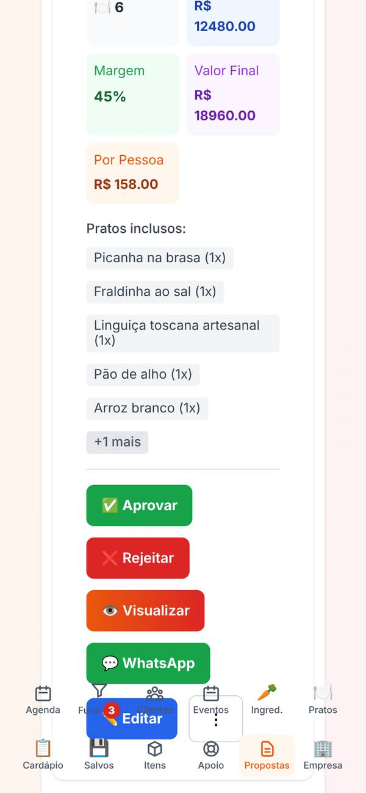

- O topo mostra o total de propostas, a receita total e o ticket médio.
- Filtre por status (Rascunho, Enviada, Aprovada, Rejeitada). Também dá para buscar e ordenar por data, valor ou nome.
- Botões de cada proposta:
  - **Enviar** (marca como Enviada);
  - **Aprovar** e **Rejeitar**;
  - **Visualizar**;
  - **💬 WhatsApp**: mensagem pronta, capítulo 9;
  - **Editar**, **Duplicar** e **Excluir**.
- Você pode selecionar várias propostas e excluir de uma vez.
- Editar uma proposta enviada ou aprovada mantém o status dela.

A mudança de status também move o negócio no Funil e atualiza a Agenda: Enviada aparece em negociação e Aprovada aparece como data fechada.

### 19.4 Visualizar, imprimir e compartilhar

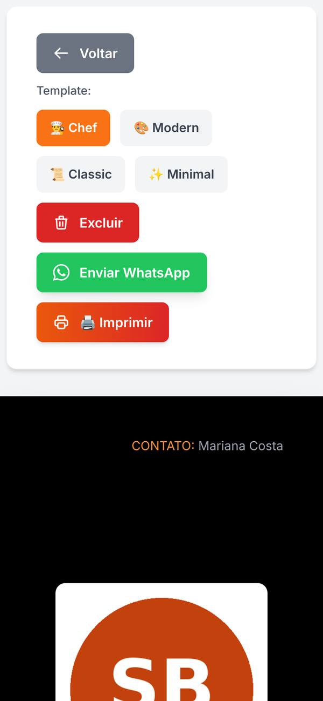

1. Toque em **"Visualizar"**.
2. Escolha o modelo: **Chef**, **Modern**, **Classic** ou **Minimal**.
3. Toque em **"Imprimir"**:
   - **No computador:** você pode imprimir ou salvar em PDF.
   - **No app para iPhone:** o PDF é gerado e você pode compartilhar ou salvar.
4. **"Enviar WhatsApp"** (Premium) manda o PDF da proposta pelo WhatsApp configurado no capítulo 20. O cliente precisa ter telefone cadastrado.

> **Exemplo de fluxo:**
> 1. **Visualizar** → modelo **Chef** → **Imprimir**, para gerar o PDF.
> 2. Mande o PDF para a cliente.
> 3. Na aba Propostas, toque em **Enviar** para marcar como Enviada.
> 4. Use o **💬 WhatsApp** com o modelo "Retorno da proposta" se ela não responder.

---

## 20. WhatsApp (Premium)

Permite enviar a proposta em PDF direto para o WhatsApp do cliente, usando a sua conta do WhatsApp Business (Meta Cloud API). As **mensagens prontas** do capítulo 9 não precisam desta configuração: elas abrem o seu próprio WhatsApp.

1. No computador, abra a aba **WhatsApp**.
2. Marque **"Habilitar envio via WhatsApp"**.
3. Informe o **Access Token** e o **Phone Number ID**. O WhatsApp Business Account ID e o número são opcionais.
4. Toque em **"Salvar Configurações"** e depois em **"Testar Conexão"**.

Para obter as credenciais:

1. Acesse o Meta Business Suite e vá em **Sistema → Contas do WhatsApp**.
2. Selecione o seu aplicativo do WhatsApp Business.
3. Copie o Access Token e o Phone Number ID.

---

## 21. Estoque de insumos (Premium)

Controla o que você tem guardado (carnes, carvão, descartáveis, temperos...) e quanto precisa comprar para os próximos eventos. As quantidades ficam na unidade do ingrediente: **kg** (peso), **L** (volume) ou **un** (unidade). Os itens de apoio ficam na unidade do item (kg de carvão, unidades de copo...).

### 21.1 Registrar compra

1. Abra a aba **📦 Estoque** e toque em **"Registrar compra"**.
2. Em cada linha, escolha o ingrediente (ou o item de apoio, marcado "(apoio)"), a quantidade, a unidade (kg ou g, L ou ml, un, embalagem ou saco/pacote do apoio) e, se quiser, o **valor total pago** e a **validade**.
3. Toque em **"Registrar compra"**.

Quando o valor pago de um ingrediente é diferente do preço do cadastro, o app pergunta se você quer **atualizar o preço do cadastro**, sugerindo o último preço pago. Marque os que quer atualizar. O preço do cadastro é o que entra nas propostas; o estoque guarda também o **custo médio** do que você comprou.

### 21.2 Saldo e estoque mínimo

- A tabela mostra o **saldo**, o **mínimo** e o **custo médio** de cada ingrediente. Use o filtro para ver só os que estão **abaixo do mínimo** ou todos os ingredientes.
- Digite o **mínimo** direto na tabela (ex.: 5 kg de picanha). Abaixo do mínimo o ingrediente fica com o selo amarelo.
- Toque no nome do ingrediente para ver o **histórico** (compras, baixas, sobras, perdas e inventários).

### 21.3 Perda e sobra

Toque em **"Perda / sobra"**:

- **Perda:** venceu, estragou, caiu. Sai do estoque.
- **Sobra:** o que voltou de um evento. Entra de novo (pode ter validade).

### 21.4 Baixa do evento

Na aba **Itens**, o quadro **"Estoque deste evento"** mostra se o estoque cobre a lista de compras. A baixa **só acontece quando você confirma**:

1. Salve o evento.
2. Toque em **"Dar baixa no estoque"**.
3. Confira a coluna **Saiu** (o previsto já vem com perda, rendimento e margem das proteínas) e ajuste o que for diferente.
4. Toque em **"Confirmar baixa"**.

Depois do evento, use **"Registrar sobra / perda"**. Se der baixa por engano, toque em **"Desfazer baixa"**: as quantidades voltam para o estoque. Cada evento tem uma baixa só.

Sem saldo suficiente, a baixa é feita assim mesmo e o saldo fica **negativo** (selo vermelho), para você lembrar de lançar a compra.

### 21.5 Compra sugerida

Toque em **"🧾 Compra sugerida"** e escolha o período (7, 15, 30 ou 60 dias). O app soma o que os **eventos fechados** (proposta **aprovada**) do período precisam, pelo cardápio de cada proposta, tira o que já está no estoque e acrescenta o mínimo.

- **Copiar lista** ou **Enviar pelo WhatsApp** para o fornecedor.
- **Comprei: registrar a compra** abre a compra já preenchida.

Propostas aprovadas sem cardápio aparecem num aviso e não entram na conta.

### 21.6 Validade

A validade é opcional na compra e na sobra. Com ela:

- A saída (baixa do evento, perda, inventário) tira **primeiro o que vence antes**.
- No topo da aba aparece o aviso **⏰ Validade** com o que vence em até **7 dias** e o que **já venceu**. No que venceu, toque em **"Lançar como perda"**.
- O filtro **"Vencendo ou vencidos"** mostra só esses itens, com o selo "vence em X dias" ou "vencido".

### 21.7 Apoio no estoque

Carvão, gás, copos, guardanapos e outros itens de apoio podem ter estoque:

1. Na aba **Apoio**, edite o item e marque **"📦 Controlar no estoque"**. O item ganha o selo **📦 estoque**.
2. Ele passa a aparecer na aba Estoque (filtro **"Só apoio"**), na compra, na perda e sobra, no inventário e na compra sugerida.
3. Na baixa do evento, o apoio controlado entra junto, com a quantidade da regra do item (por convidado, por kg de carne, por hora ou fixa).

Itens que não são insumo (churrasqueiro extra, aluguel) ficam sem marcar.

### 21.8 Inventário

Toque em **"📋 Inventário"**, escolha o que contar (itens com estoque, todos ou uma categoria) e digite ao lado de cada item o que contou. A coluna **Diferença** mostra quanto muda. Só os itens preenchidos são alterados: o saldo passa a ser o contado.

### 21.9 Sem internet

Compra, baixa, sobra, perda e inventário funcionam sem internet (por exemplo, no evento, no iPhone):

- O lançamento fica guardado no aparelho e o aviso **📶 esperando internet** aparece no topo. Os saldos já mostram o lançamento, com "aguardando envio".
- Quando a conexão volta, o envio é automático (ou toque em **"Enviar agora"**). O mesmo lançamento nunca é gravado duas vezes.
- Se o servidor recusar algum (ex.: baixa repetida do mesmo evento), aparece o aviso com o motivo.

O estoque mínimo só muda com internet.

---

## 22. Vendas (Premium)

A aba **Vendas** é para quem vende pratos no dia a dia: restaurante, marmitaria, lanchonete, delivery ou quem faz encomendas. Ela tem cinco partes: **Vender**, **Pedidos**, **Itens à venda**, **Estoque** (dos pratos prontos) e **Resumo**.

### 22.1 O que está à venda

**Pratos:** a opção fica no próprio prato. Abra o prato na aba **Pratos** (✏️) e marque **"🧾 Vender este prato"**:

- **Preço de venda:** vem preenchido com o preço sugerido do prato. Prato por porção é vendido por porção; prato calculado por peso (R$/100 g) é vendido por **kg** (preço de 100 g × 10). Você pode mudar o preço e a unidade (porção, unidade ou kg).
- O custo vem da ficha técnica e aparece com o **CMV** (custo ÷ preço): verde até o CMV desejado (Custos da empresa), amarelo até 5 pontos acima e vermelho acima disso.
- **Categoria na venda:** agrupa os itens no PDV (ex.: Marmitas, Pratos, Sobremesas).
- **Controlar estoque de prontos:** para marmitas, congelados e bolos. Você lança o que produziu em **Vendas → Estoque** ou na aba **Estoque → Pratos prontos e revenda**. Pratos feitos na hora não precisam.
- **Não deixar vender sem saldo:** bloqueia a venda quando acaba. Sem essa opção, o app avisa "sem saldo" e deixa vender (o saldo fica negativo).
- Toque em **"Salvar Alterações"**. O prato ganha a etiqueta **"🧾 À venda"** na lista de pratos. Para parar de vender, desmarque a opção e salve (os pedidos antigos continuam).

**Itens à venda** (dentro da aba Vendas):

- **"+ Produto de revenda":** bebidas, sobremesas compradas prontas ou itens sem ficha técnica. Informe o preço e, se quiser, o custo.
- A tabela mostra tudo que está à venda. Dá para ajustar nome, categoria, preço, unidade e estoque ("controla" e "bloqueia sem saldo") sem abrir o prato.
- **"Tirar":** o item sai do PDV. Para trazer de volta, marque "Mostrar os tirados do cardápio" e toque em **"Voltar"**.

### 22.2 Vender (PDV)

1. Toque nos itens para montar o pedido (cada toque soma 1). Itens por kg pedem o peso.
2. Em cada linha: **+** e **−**, **"+ observação"** (ex.: "sem cebola") e **×** para tirar.
3. Escolha o **tipo**: Balcão, Mesa (número da mesa), Retirada, Delivery (endereço e taxa de entrega) ou Encomenda (data e hora).
4. Nome e telefone do cliente são opcionais no balcão e na mesa, e obrigatórios na retirada, no delivery e na encomenda. Se o telefone já está em Clientes, o pedido fica ligado à ficha.
5. Desconto, forma de pagamento (Dinheiro, PIX, Crédito, Débito ou Fiado) e **"Já está pago"**. No dinheiro, informe o valor recebido e o app mostra o **troco**.
6. Toque em **"Finalizar e imprimir"**.

O número do pedido **recomeça todo dia** (001, 002...). **"+ Item avulso"** lança algo fora do cardápio (não mexe no estoque). No celular, o pedido abre pela barra escura **"Ver pedido"**.

### 22.3 Impressão do pedido

Toque em **"🖨️ Impressão"** para configurar:

- **Tamanho do papel:**
  - **A4 · 2 vias (cliente + recebimento)** (padrão): uma folha A4 dividida ao meio por um pontilhado ("✂ recorte aqui"). Em cima vai a **via do cliente**; embaixo, a **via da empresa**, um comprovante de entrega com "Declaro que recebi os itens deste pedido" e espaço para nome legível, assinatura e data e hora. As duas vias têm logo, dados da empresa, itens, totais e pagamento. Pedido com muitos itens sai em duas folhas, uma via em cada.
  - Térmica 80 mm, térmica 58 mm, folha A4 ou A5: uma via por página.
  - Funciona com qualquer impressora instalada no computador ou no celular.
- **Vias:** via da cozinha (número grande, itens e observações, sem preços) e via do cliente (logo e dados da empresa, preços, pagamento, troco e "Não é documento fiscal"). No formato A4 · 2 vias, a via da cozinha é opcional e sai em outra folha.
- **Imprimir sozinho ao finalizar** e o **rodapé** da via do cliente.
- **"Imprimir teste"** para conferir antes.

No navegador abre a janela de impressão. No app do iPhone, o pedido vira PDF para imprimir (AirPrint) ou compartilhar. Na impressora térmica, deixe o papel do driver como rolo de 80 mm (ou 58 mm) e as margens no mínimo.

### 22.4 Pedidos

- **Pedidos do dia:** lista do dia escolhido, com filtro (em aberto, todos ou por situação). Atualiza sozinha a cada 30 segundos.
- Avance a situação: **Novo → Em preparo → Pronto → Entregue**.
- **"🖨️ Imprimir"** reimprime, **"Marcar pago"** registra o pagamento do fiado e **"Cancelar"** cancela o pedido. O que saiu do estoque volta.
- **Encomendas:** as encomendas futuras em aberto, por data. A encomenda só sai do estoque quando é marcada como **Entregue**.

### 22.5 Estoque dos pratos prontos

Fica em dois lugares, com os mesmos dados: **Vendas → 📦 Estoque** e a aba principal **Estoque → 🍲 Pratos prontos e revenda** (a outra parte, **🥕 Insumos**, é o estoque de ingredientes e apoio). Só aparecem os pratos com **"Controlar estoque de prontos"** marcado no próprio prato e os produtos de revenda com **"controla"**.

- **"🍲 Produzi / chegou":** lance o que ficou pronto (ou a revenda que chegou, com o custo). A validade é opcional.
- **Perda** (venceu, estragou) e **Inventário** (o saldo passa a ser o que você contou).
- **Mínimo:** a quantidade que você quer ter sempre pronta.
- **Validade:** o aviso aparece no dia anterior. Vencido tem o botão **"Lançar como perda"**.
- **Produção sugerida:** escolha amanhã, 3, 7 ou 15 dias. Conta: encomendas do período + mínimo − saldo. **"Produzi isso: lançar"** abre o lançamento já preenchido.

O que sai primeiro do estoque é o que vence antes.

> **Exemplo:** você tem 8 marmitas de strogonoff, mínimo de 4 e uma encomenda de 12 para amanhã. A produção sugerida é 12 + 4 − 8 = **8 marmitas**.

### 22.6 Resumo

Escolha Hoje, Ontem, 7 dias ou Este mês e veja: total vendido, número de pedidos (e cancelados), ticket médio, **lucro bruto** (vendas − custo dos itens), o que falta **receber** (fiado e não pagos), as vendas por forma de pagamento e por item, com o lucro de cada um. Os pedidos contam no dia em que foram feitos.

### 22.7 Sem internet

O pedido é registrado e impresso na hora com um número provisório (ex.: **P-4B96**, "sem internet"). Os saldos já descontam o pedido. Quando a conexão volta, ele é enviado sozinho (ou toque em **"Enviar agora"**) e recebe o número do dia. A produção, a perda e o inventário também funcionam sem internet. Mudar a situação de um pedido, cancelar e editar o cardápio precisam de conexão.

---

## 23. Planos e recursos

### OFFLINE

- Dados guardados apenas no aparelho, sem sincronização.
- Ingredientes, pratos, cardápios, eventos, cálculo de custos e propostas.
- Agenda.

### STANDARD

- Tudo do OFFLINE.
- Dados na nuvem e acesso de vários aparelhos, com sincronização automática.

### PREMIUM

- Tudo do STANDARD.
- CRM: Funil de Vendas, ficha do cliente, tarefas e lembretes, tarefas automáticas e Relatórios.
- Recursos com IA: importar ingredientes, templates, atualizar preços, importar receitas e montar cardápios.
- Envio de propostas em PDF pelo WhatsApp.
- Estoque de insumos: compras, validade, apoio, inventário, baixa do evento, sobras, perdas, compra sugerida e lançamentos sem internet.
- Vendas: pratos à venda (marcados no próprio prato) e produtos de revenda, PDV, pedidos e encomendas, impressão do pedido, estoque de pratos prontos, produção sugerida e resumo das vendas.

Recursos que não fazem parte do seu plano aparecem com um cadeado.

---

## 24. Uso no celular

### 24.1 App para iPhone

O app para iPhone usa a mesma conta da versão web: entre com o mesmo e-mail e senha e seus dados aparecem iguais.

### 24.2 Instalar a versão web na tela inicial

**iPhone e iPad (Safari):**

1. Abra o sistema no Safari.
2. Toque em Compartilhar (quadrado com seta para cima).
3. Toque em **"Adicionar à Tela de Início"** e confirme.

**Android (Chrome):**

1. Abra o sistema no Chrome.
2. Toque no menu de três pontos.
3. Toque em **"Adicionar à tela inicial"** ou **"Instalar app"** e confirme.

### 24.3 Dicas

- As abas ficam na barra inferior. O botão "Empresa" abre os dados da empresa, o suporte e este manual.
- No Funil, use o menu "Mover para…" no lugar de arrastar.
- Use o celular na horizontal para tabelas grandes.

---

## 25. Solução de problemas

### Não consigo entrar

- Confira se o e-mail está correto.
- Use "Esqueci minha senha" para criar uma nova senha.
- Se a conta não for encontrada, fale com o suporte.

### Os dados não aparecem ou não atualizam

- Confira sua conexão com a internet (planos STANDARD e PREMIUM).
- Recarregue a página. No computador: Ctrl+Shift+R (Windows) ou Cmd+Shift+R (Mac).
- Saia e entre novamente.

### A aba Funil aparece bloqueada

- O Funil de Vendas faz parte do plano PREMIUM.

### O botão "Mensagem pronta" não aparece

- Na ficha, ele só aparece quando o cliente tem telefone cadastrado.
- Recarregue a página para receber a versão mais nova.

### A mensagem pronta saiu com uma frase estranha

- Faltou alguma informação (por exemplo, a data ou os convidados na proposta). Complete a proposta ou ajuste o texto antes de enviar.

### A data não aparece na Agenda

- A data só aparece quando a proposta está como "Enviada" (em negociação) ou "Aprovada" (fechada).
- Confira se a data do evento foi informada na proposta.

### Os Relatórios mostram "Sem origem"

- São contatos sem origem preenchida, ou propostas antigas de antes do CRM. Abra a ficha do cliente e escolha a origem.

### Os custos dos meus pratos mudaram

- Isso é a correção da perda, que antes era contada duas vezes. Os custos e preços sugeridos ficaram mais baixos e corretos.
- Revise o markup dos pratos com mais perda (carnes com osso, peixes). Talvez valha subir o markup para manter o preço de venda.

### Valores zerados ou estranhos

- Confira se todos os ingredientes têm preço.
- Confira o número de convidados e o consumo por pessoa no Cardápio.
- Depois de mudar preços, use "Atualizar Ingredientes" na aba Pratos.

### A proposta não gera PDF

- Salve a proposta antes de visualizar.
- Confira se ela tem cardápio e convidados.
- Aguarde a página carregar por completo e tente de novo.

---

## 26. Suporte

- No painel da empresa, use o botão **"Falar com o suporte"**. No celular, o painel abre pelo botão "Empresa" na barra inferior. O botão também aparece na tela de acesso.
- Ou envie um e-mail para: rafael.oliveira.azambuja@gmail.com

Ao escrever, conte o que aconteceu, em qual aba e, se possível, envie um print da tela.

---

## Primeiro uso: lista rápida

- Entrar com e-mail e criar a senha.
- Preencher os Dados da Empresa e colocar o logo.
- Cadastrar os principais ingredientes com preço.
- Cadastrar os Custos da empresa (impostos, taxas, custos fixos e lucro).
- Criar os primeiros pratos com markup.
- Montar e salvar um cardápio.
- Cadastrar um cliente (ou criar o contato no Funil, com a origem).
- Criar e visualizar a primeira proposta.
- Marcar a proposta como Enviada e acompanhar no Funil e na Agenda.
- Ajustar os textos em "Editar modelos" e cadastrar o link de avaliação do Google.

---

Manual do Usuário - Calculadora de Precificação
